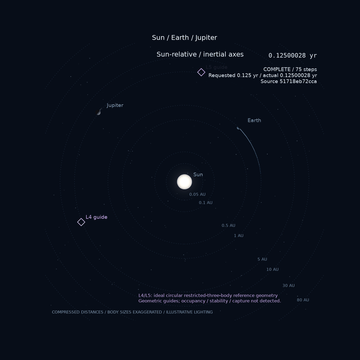

# Sidereel

A planar N-body sandbox. Build a system, watch gravity work, keep the picture.



One year of the Sun, Earth, and Jupiter, rendered by `sidereel-cli`.

## Features

- Unsoftened Newtonian gravity in the plane. Masses pull on each other. Test particles only fall.
- A fixed-step Yoshida integrator. A close encounter halts the run and keeps the last good state.
- A player for a finished `.sidereel` file. Live view is the default: one top-down plot, no axis values, orbit trails as lines, and the duration underneath. Overlay and the inner/outer split view (name TBD) are optional. A three-dimensional recording is the same top-down projection.
- The same current presets as sweep files under `experiments/`. `sidereel --build` records them. The player does not calculate.
- The earlier Observatory sandbox is still in the package: a PyQt6 window, a sidebar (Menu, or M), and live insertion. `sidereel` opens the player.
- Add a moon by choosing its planet and a center-to-center distance in kilometers. Gravity moves the moon after that; the planet does not hold it in place.
- Add a catalog or custom body while a run is paused. Drop it in the scene, drag the velocity arrow, then confirm. The clock and the other bodies stay put. Reset returns to the starting setup.
- A CLI that integrates the system and writes a PNG. No display required.
- Save the initial setup, or save the current state as a new setup. Calculate a recording, then play the samples. Playback speed does not recalculate the motion.
- Optional perfect merge for nonstellar contact. Point tracers are absorbed with no mass feedback. Contact with a star halts. The default still halts on a close encounter and does not merge.
- Optional tidal dissipation on close passes of massive bodies. It is off unless the experiment turns it on, so a tide-free run is unchanged.
- An isolated planet holds its period to a relative 1e-7. At 1 AU, solar gravity sits about 30 ppm above JPL's GM, inside a 1e-4 bound.
- A late-stage formation prototype that follows rocky embryos, records which parcels built each body, and compares two runs from one checkpoint.

## Prerequisites and installation

Python 3.10 or newer.

```bash
pipx install sidereel
```

`sidereel` opens the player. `sidereel-cli` renders and builds experiment files.

The project is not on PyPI yet. Until the first release, install from git:

```bash
pipx install git+https://github.com/AllHailSeizure/sidereel
```

From a checkout:

```bash
pip install -e .
```

On Debian and Ubuntu the desktop also needs `libegl1` and `libopengl0`.

## Usage

Play a finished recording:

```bash
sidereel experiment.sidereel
```

With no file, `sidereel` opens the player home. It lists the preset sweep files under `experiments/` and an **Open playback file** button. It does not calculate. Pass a `.sidereel` playback file. A source `.json` is refused with a message to run `--build` first.

```bash
sidereel
```

Build an experiment from a file:

```bash
sidereel --new experiment.json
sidereel --build experiment.json
sidereel --build experiments/heavier-star.json
```

`--new` writes a blank experiment: dimensions, catalog bodies, opt-in physics, and the run. Newtonian gravity is what Sidereel uses. Edit that file, then `--build` checks it and writes `experiment.sidereel` beside it. The playback file holds the samples and duration for one run, or for each run of a sweep or an open scan. Preset files use that same `--build` command. `sidereel-cli` still renders a catalog system, and it accepts `--new` and `--build`.

### Player

**Live view** is the default. One top-down plot, no axis values, orbit trails as lines, duration underneath. The field is dark and the run label is gold. A three-dimensional recording uses that same view: the first two components, drawn as a top-down projection.

**Overlay** draws every equal-time run together, colored by the swept value, plus the observable you pick: heliocentric distance (the default), speed, or trajectories only. A halted, cancelled, or otherwise shorter member stays labeled and is left out of the equal-time overlay. A completed run that recorded a collision stays in the overlay and is marked with when and why. Export the overlay as PNG, SVG, and CSV.

**Inner/outer split view (name TBD)** is the true-scale pair. The inner panel stays at ±2 AU (Mercury through Mars) and the outer panel stays at ±35 AU (Jupiter through Neptune). Axis values are in AU. Export that view as PNG or GIF.

The control board sits under the plot:

| Control | Action |
| --- | --- |
| Within the run | Simulated years advanced per wall-clock second |
| Between runs | How long the player dwells after a run ends before it steps to the next |
| Reset each run | Each run, including one chosen with the slider, starts at its first sample. Clear it and the playhead keeps its timestamp, clamped to that run |
| Pause | Hold the playhead. The button then reads Play |
| Run slider | Switch which recorded member is on screen. Hidden when the file has one run. Moving it does not recalculate |
| Compare | Live view and the inner/outer split show one chosen run on the left and another on the right. The left side follows the slider. Overlay stays one plot of the equal-time runs |

The shipped preset files are one controlled variable each. Where a range was left open, the file is a single run at the value that preset already uses. The duration written in those files is a proposal: one year, and half a year for the capture flyby.

| File | Swept value |
| --- | --- |
| `experiments/solar-system.json` | Sun mass, one run at the catalog value; planets fixed |
| `experiments/heavier-star.json` | Sun mass from 1 to 2, step 0.1; catalog vectors fixed |
| `experiments/earth-moon.json` | Earth mass, one run at the catalog value; Moon at 384,400 km |
| `experiments/asteroid-ring.json` | Ring radius, one run at 3.2 AU; 32 even angles, seed 7 |
| `experiments/sun-earth-jupiter.json` | Sun mass, one run at the catalog value |
| `experiments/sun-jupiter-ring.json` | Jupiter mass from 0 (Jupiter removed, the matched control) to the catalog mass, five equal steps; ring fixed |
| `experiments/binary-star-merger.json` | One run, no swept variable, published head-on window |
| `experiments/capture-flyby.json` | Approach speed from 0.5 to 2 AU per Julian year, step 0.5. An example, not a menu preset. It can show a temporary flyby |

Sun–Jupiter ring places 32 mass-zero rocks evenly around the Sun at 3.2 AU (seed 7). Rotating view keeps the Sun–Jupiter direction fixed. Hollow L4 and L5 marks are geometric guides, not rocks. Select a rock to read its separation from Jupiter and how long the drawn trail is. Matched no-Jupiter run uses the same rock starting vectors. Collision mode is none, and a halt or a shorter run is labeled as incomplete.

Add body works in the starting setup and during a paused run. A click drops the body, the arrow sets its speed and direction, and confirm adds it without rewinding the clock. The circular arrow is only a two-body start around the body you pick, including a second star. Reset drops a live insertion and returns to the starting setup.

Render the year in the picture:

```bash
sidereel-cli --star sun --planet earth --planet jupiter --years 1 --output output/sidereel.png
```

Starting positions only. The default is the Sun, Earth, and Jupiter:

```bash
sidereel-cli --output output/start.png
```

Inner planets, half a year:

```bash
sidereel-cli --star sun --planet mercury --planet venus --planet earth --years 0.5 --output output/inner.png
```

`--star` is `proxima`, `sun`, `sirius`, or `rigel`. Repeat `--planet` for each body: `mercury`, `venus`, `earth`, `mars`, `jupiter`, `saturn`, `uranus`, `neptune`, `pluto`, `ceres`.

`--years` works only with `--output`. So do `--sample-stride` and `--max-recording-mib`. Name bodies without `--output` and the Matplotlib window opens instead.

In a checkout, `python -m simulations.star_system` is the same program. `sidereel-cli --help` lists every flag.

## Formation prototype

`simulations.star_system.formation` starts from a star and massive embryos, merges them on contact, and keeps the mass each parcel contributed. Save a checkpoint, change one velocity, and play both runs across the years they share. The bundled embryo radii are inflated, and the run does not include gas or fragmentation. The measured benchmark and the recommended scope are in [docs/formation-feasibility.md](docs/formation-feasibility.md).

## License

MIT. Copyright 2026 Nate Bosma. See [LICENSE](LICENSE).
